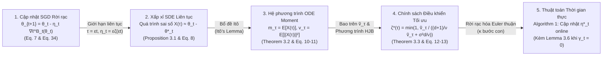

# T7: Hồi quy Tuyến tính dưới Dịch chuyển Phân phối — Xấp xỉ SDE, Phương trình Moment ODE & Điều khiển Tối ưu (Mục 3)

Tài liệu này phân tích chi tiết cơ sở toán học của **Mục 3 (Linear Regression)** trong bài báo *"Learning Rate Schedules in the Presence of Distribution Shift"* (Fahrbach et al., ICML 2023), trả lời trọn vẹn 3 câu hỏi cốt lõi (**Làm gì? Vì sao cần? Hoạt động thế nào?**) cho từng bước dẫn xuất từ cập nhật SGD rời rạc đến **Algorithm 1**, phục vụ trực tiếp cho **Slide 13, Slide 14 và Slide 15** của nhóm.

---

## 0. Tóm tắt Luồng Logic Mục 3 (Bức tranh Tổng thể)

Trong bài toán Hồi quy Tuyến tính Trực tuyến (Online Least Squares), mục tiêu của nhóm tác giả là tìm ra **lịch trình tốc độ học $\eta^*_t$ tối ưu chính xác** (chứ không chỉ dừng ở việc tối ưu một cận trên thô). Để làm được điều đó, Mục 3 triển khai chuỗi 5 bước chuyển đổi toán học chặt chẽ:



---

## 1. Thiết lập Bài toán Hồi quy Tuyến tính có Trọng số Biến thiên (Eq. 7)

### 1.1. Mô hình sinh dữ liệu và Dịch chuyển Nhãn (Response Shift)
Tại mỗi bước thời gian rời rạc $t = 1, 2, \dots, T$, bộ học nhận một mini-batch gồm $B_t$ mẫu độc lập $z_{t,k} = (x_{t,k}, y_{t,k}) \in \mathbb{R}^d \times \mathbb{R}$ ($k = 1, \dots, B_t$) được sinh theo mô hình tuyến tính có hệ số thay đổi theo thời gian (time-varying coefficient model):

$$y_{t,k} = \langle x_{t,k}, \theta^*_t \rangle + \varepsilon_{t,k}, \quad \text{với } x_{t,k} \stackrel{\text{i.i.d.}}{\sim} \mathcal{N}(0, I_d), \quad \varepsilon_{t,k} \stackrel{\text{i.i.d.}}{\sim} \mathcal{N}(0, \sigma^2) \tag{7}$$

* **Đặc trưng đầu vào ($x_{t,k}$)**: Giữ phân phối chuẩn tắc đẳng hướng $\mathcal{N}(0, I_d)$ không đổi theo thời gian.
* **Sự dịch chuyển phân phối (Distribution Shift)**: Đến từ việc vector trọng số tối ưu thực sự $\theta^*_t \in \mathbb{R}^d$ dịch chuyển ở mỗi bước với biên độ $\gamma_t := \|\theta^*_t - \theta^*_{t+1}\|_2$, kéo theo phân phối của biến phản hồi $y_{t,k} \mid x_{t,k}$ thay đổi liên tục (**Label / Response Shift**).
* **Hàm mất mát điểm (Least-Squares Loss)**:
  $$\ell(\theta, z_{t,k}) = \frac{1}{2}\left(y_{t,k} - \langle x_{t,k}, \theta \rangle\right)^2$$

### 1.2. Biểu thức Giải tích của Dynamic Regret Kỳ vọng
Một tính chất đặc biệt quan trọng của hồi quy tuyến tính với $x_{t,k} \sim \mathcal{N}(0, I_d)$ là **Dynamic Regret kỳ vọng tại bước $t$ bằng đúng một nửa bình phương khoảng cách Euclid từ trọng số hiện tại $\theta_t$ tới nghiệm tối ưu $\theta^*_t$**:

$$\begin{aligned}
\mathbb{E}[\text{reg}_t] &= \mathbb{E}\left[\bar{\ell}_t(\theta_t) - \bar{\ell}_t(\theta^*_t)\right] \\
&= \frac{1}{2}\mathbb{E}\left[\left(\langle x_{t,k}, \theta_t - \theta^*_t \rangle + \varepsilon_{t,k}\right)^2\right] - \frac{1}{2}\mathbb{E}\left[\varepsilon_{t,k}^2\right] \\
&= \frac{1}{2}\mathbb{E}\left[(\theta_t - \theta^*_t)^\top \underbrace{\mathbb{E}[x_{t,k} x_{t,k}^\top]}_{I_d} (\theta_t - \theta^*_t)\right] = \frac{1}{2}\mathbb{E}\left[\|\theta_t - \theta^*_t\|_2^2\right]
\end{aligned}$$

> **Ý nghĩa cốt lõi**: Để cực tiểu hóa tổng Dynamic Regret $\sum_{t=1}^T \mathbb{E}[\text{reg}_t]$, ta cần và chỉ cần theo dõi và cực tiểu hóa **moment bậc hai của vector sai số** $\|\theta_t - \theta^*_t\|_2^2$ theo thời gian.

---

## 2. Xấp xỉ Phương trình Vi phân Ngẫu nhiên (SDE) — Công thức (8) & Proposition 3.1

### 2.1. Ba câu hỏi cốt lõi (Dùng cho Slide 13)
* **Làm gì?** Chuyển phương trình cập nhật Mini-batch SGD rời rạc theo bước $t \in \mathbb{N}$ sang một **Phương trình Vi phân Ngẫu nhiên (SDE)** theo biến thời gian liên tục $\tau = \varepsilon t \in \mathbb{R}_{\ge 0}$ mô tả quỹ đạo của vector sai số $X(\tau) \approx \theta_t - \theta^*_t$.
* **Vì sao cần?** Trong miền rời rạc, $\theta_{t+1}$ phụ thuộc phức tạp vào tích của các ma trận ngẫu nhiên $\prod (I - \eta_t \frac{1}{B_t} X_t^\top X_t)$, khiến việc giải tìm nghiệm đóng cho chuỗi $\eta^*_1, \dots, \eta^*_T$ là bất khả thi. Khi chuyển sang miền liên tục với bước nhảy tối đa $\varepsilon$ nhỏ, ta có thể sử dụng **Giải tích ngẫu nhiên (Bổ đề Itô)** và **Lý thuyết điều khiển tối ưu (Phương trình HJB)** để tìm nghiệm chính xác.
* **Hoạt động thế nào?**
  1. Đặt biến thời gian liên tục $\tau = \varepsilon t$, trong đó $\varepsilon > 0$ là tốc độ học tối đa cho phép ($\eta_{\max}$).
  2. Biểu diễn tốc độ học và kích thước batch qua các hàm điều khiển trơn $\zeta(\tau) \in [0, 1]$ và $\nu(\tau) > 0$:
     $$\eta_t = \varepsilon \zeta(\varepsilon t), \qquad B_t = \lceil \varepsilon \nu(\varepsilon t) \rceil$$
  3. Gọi $Y(\tau) \in \mathbb{R}^d$ là đường cong nội suy trơn của chuỗi nghiệm tối ưu sao cho $Y(\varepsilon t) = \theta^*_t$. Khi đó, vận tốc trôi của nghiệm tối ưu trong miền liên tục là $Y'(\varepsilon t) \approx \frac{\theta^*_{t+1} - \theta^*_t}{\varepsilon}$, với chuẩn $\|Y'(\varepsilon t)\|_2 \approx \frac{\gamma_t}{\varepsilon}$.

### 2.2. Cấu trúc của Phương trình SDE (Công thức 8)
Từ cập nhật SGD rời rạc (Phụ lục A.1, Công thức 34–35):
$$\theta_{t+1} - \theta_t = -\eta_t(\theta_t - \theta^*_t) - \eta_t \xi_t$$
trong đó nhiễu gradient trung bình mẫu $\xi_t$ có kỳ vọng bằng $0$ và ma trận hiệp phương sai chính xác (nhờ Bổ đề Stein — Lemma D.1) bằng:
$$\text{Cov}(\xi_t \mid \theta_t) = \frac{1}{B_t} D_t = \frac{1}{B_t}\left(\left(\|\theta_t - \theta^*_t\|_2^2 + \sigma^2\right)I_d + (\theta_t - \theta^*_t)(\theta_t - \theta^*_t)^\top\right)$$

Áp dụng phép xấp xỉ Euler–Maruyama, vector sai số liên tục $X(\tau) \approx \theta_t - \theta^*_t$ tuân theo phương trình SDE:

$$\mathrm{d}X(\tau) = -\underbrace{\left(\zeta(\tau)X(\tau) + Y'(\tau)\right)\mathrm{d}\tau}_{\text{Thành phần Trôi tất định (Drift)}} + \underbrace{\frac{\zeta(\tau)}{\sqrt{\nu(\tau)}}\left(\left(\|X(\tau)\|_2^2 + \sigma^2\right)I_d + X(\tau)X(\tau)^\top\right)^{1/2}\mathrm{d}W(\tau)}_{\text{Thành phần Khuếch tán ngẫu nhiên (Diffusion)}} \tag{8}$$

với $X(0) = \theta_0 - \theta^*_0$ và $W(\tau) \in \mathbb{R}^d$ là chuyển động Brown chuẩn $d$ chiều.

* **Giải thích trực giác từng số hạng trong SDE (8)**:
  * $-\zeta(\tau)X(\tau)\mathrm{d}\tau$: **Lực kéo hội tụ của SGD** — kéo sai số $X(\tau)$ về $0$ với tốc độ tỷ lệ thuận với hệ số học $\zeta(\tau)$.
  * $-Y'(\tau)\mathrm{d}\tau$: **Lực kéo lệch do Distribution Shift** — vì đích ngắm $\theta^*_t$ đang chạy đi với vận tốc $Y'(\tau)$, vector sai số $X(\tau) = \theta(\tau) - Y(\tau)$ bị đẩy lệch đi một lượng $-Y'(\tau)\mathrm{d}\tau$.
  * Số hạng chứa $\mathrm{d}W(\tau)$: **Nhiễu khuếch tán mini-batch** — tỷ lệ thuận với $\frac{\zeta(\tau)}{\sqrt{\nu(\tau)}} = \frac{\eta_t}{\sqrt{\varepsilon B_t}}$. Gồm 2 nguồn nhiễu: nhiễu tự thân do sai số mô hình $\|X(\tau)\|_2^2$ (multiplicative noise) và nhiễu nhãn $\sigma^2$ (additive noise).

### 2.3. Bảo chứng Sai số Xấp xỉ (Proposition 3.1)
Dưới hai giả thiết trơn Lipschitz **A1** (các hàm điều khiển $\zeta, \zeta/\sqrt{\nu}$ bị chặn và Lipschitz) và **A2** (quỹ đạo $Y(\tau)$ bị chặn và $\|Y'(\tau)\|_2 \le \Gamma/\varepsilon$), **Proposition 3.1** chứng minh bằng bất đẳng thức martingale Doob và bất đẳng thức Grönwall rằng: với xác suất ít nhất $1 - e^{-u^2}$,

$$\sup_{t \in [0, T/\varepsilon] \cap \mathbb{Z}_{\ge 0}} \left|\|X(t\varepsilon)\|_2^2 - \|\theta_t - \theta^*_t\|_2^2\right| \le C\sqrt{\varepsilon}$$

Suy ra khoảng cách giữa Regret thực tế của SGD rời rạc và moment bậc hai của SDE chỉ lệch tối đa $\mathcal{O}(\sqrt{\varepsilon})$:
$$\left|\mathbb{E}[\text{reg}_t] - \frac{1}{2}\mathbb{E}[\|X(t\varepsilon)\|_2^2]\right| \le C\sqrt{\varepsilon}$$

---

## 3. Phương trình Moment ODE & Điều khiển Tối ưu HJB — Theorem 3.2 & Theorem 3.3

### 3.1. Ba câu hỏi cốt lõi (Dùng cho Slide 14)
* **Làm gì?** Dùng Bổ đề Itô (Itô's Lemma) để chuyển phương trình ngẫu nhiên SDE (8) thành **hệ phương trình vi phân thường (ODE) tất định** cho kỳ vọng sai số $m_\tau := \mathbb{E}[X(\tau)]$ và bình phương sai số kỳ vọng $v_\tau := \mathbb{E}[\|X(\tau)\|_2^2]$, sau đó giải bài toán điều khiển tối ưu bằng **phương trình Hamilton–Jacobi–Bellman (HJB)**.
* **Vì sao cần?** Giải trực tiếp SDE ngẫu nhiên trên không gian $\mathbb{R}^d$ rất phức tạp, nhưng đại lượng ta cần tối ưu trong hàm mục tiêu Regret chỉ là một **số vô hướng duy nhất** $v_\tau = \mathbb{E}[\|X(\tau)\|_2^2] \in \mathbb{R}_{\ge 0}$. Chuyển về ODE của $v_\tau$ giúp rút gọn bài toán $d$ chiều ngẫu nhiên về bài toán điều khiển 1 chiều tất định!
* **Hoạt động thế nào?**

#### Bước A: Hệ phương trình ODE cho Moment bậc nhất và bậc hai (Theorem 3.2)
Lấy kỳ vọng hai vế của (8) và áp dụng Bổ đề Itô cho hàm vô hướng $\phi(X) = \|X\|_2^2$ (với $\nabla \phi(X) = 2X$ và $\nabla^2 \phi(X) = 2I_d$, nên $\frac{1}{2}\text{tr}(g^\top \nabla^2\phi \, g) = \frac{\zeta^2}{\nu}\text{tr}(((\|X\|^2+\sigma^2)I_d + XX^\top)) = \frac{\zeta^2}{\nu}((d+1)\|X\|^2 + d\sigma^2)$), ta thu được **Theorem 3.2**:

$$\begin{aligned}
m'_\tau &= -\zeta(\tau)m_\tau - Y'(\tau) \tag{10} \\
v'_\tau &= \left((d+1)\frac{\zeta(\tau)^2}{\nu(\tau)} - 2\zeta(\tau)\right)v_\tau + \frac{\zeta(\tau)^2}{\nu(\tau)}\sigma^2 d - 2 m_\tau^\top Y'(\tau) \tag{11}
\end{aligned}$$

#### Bước B: Khử sự phụ thuộc hướng bằng Quá trình Bao trên $\tilde{v}_\tau$ (Công thức 12)
Trong phương trình (11), số hạng giao thoa $-2m_\tau^\top Y'(\tau)$ phụ thuộc vào góc giữa vector sai số trung bình $m_\tau \in \mathbb{R}^d$ và vector vận tốc dịch chuyển $Y'(\tau) \in \mathbb{R}^d$ (vốn không quan sát được đầy đủ trong thực tế). Áp dụng bất đẳng thức Cauchy–Schwarz và bất đẳng thức Jensen ($\|m_\tau\|_2 = \|\mathbb{E}[X(\tau)]\|_2 \le \sqrt{\mathbb{E}[\|X(\tau)\|_2^2]} = \sqrt{v_\tau}$):

$$|m_\tau^\top Y'(\tau)| \le \|Y'(\tau)\|_2 \|m_\tau\|_2 \le \|Y'(\tau)\|_2 \sqrt{v_\tau}$$

Thay chặn trên này vào (11), bài báo định nghĩa **quá trình bao trên (upper-envelope process) $\tilde{v}_\tau \ge v_\tau$** thông qua ODE vô hướng:

$$\tilde{v}'_\tau = \underbrace{\left((d+1)\frac{\zeta(\tau)^2}{\nu(\tau)} - 2\zeta(\tau)\right)\tilde{v}_\tau}_{\text{Động học thu hẹp sai số hiện tại}} + \underbrace{\frac{\zeta(\tau)^2}{\nu(\tau)}\sigma^2 d}_{\text{Nhiễu phương sai nhãn}} + \underbrace{2\|Y'(\tau)\|_2 \sqrt{\tilde{v}_\tau}}_{\text{Tác động bơm sai số của Distribution Shift}} \tag{12}$$

#### Bước C: Dẫn xuất Chính sách Tốc độ học Tối ưu bằng Phương trình HJB (Theorem 3.3)
Bài toán tìm lịch trình tốc độ học tối ưu trở thành bài toán điều khiển tối ưu liên tục:
$$\min_{\zeta: [0, T] \to [0, 1]} \int_0^T \tilde{v}_\tau \, \mathrm{d}\tau \quad \text{thỏa mãn ràng buộc ODE (12).}$$

Gọi $V(\tilde{v}, \tau)$ là hàm giá trị (value function) — tổng chi phí tối thiểu còn lại từ thời điểm $\tau$ đến $T$. Phương trình đạo hàm riêng **Hamilton–Jacobi–Bellman (HJB)** (Phụ lục A.3, Công thức 47) có dạng:
$$\frac{\partial V}{\partial \tau} + \min_{\zeta \in [0, 1]} \left[\frac{\partial V}{\partial \tilde{v}} \cdot \tilde{v}'_\tau(\zeta) + \tilde{v}_\tau\right] = 0$$

Vì sai số $\tilde{v}_\tau$ càng lớn thì tổng Regret tương lai càng cao nên $\frac{\partial V}{\partial \tilde{v}} > 0$. Do đó, việc cực tiểu hóa vế trái theo $\zeta \in [0, 1]$ tương đương với **cực tiểu hóa trực tiếp tốc độ biến thiên tức thời $\tilde{v}'_\tau(\zeta)$ tại mọi thời điểm $\tau$**!
Xét hàm bậc hai theo $\zeta$ trong $\tilde{v}'_\tau$:
$$\Phi(\zeta) = \left(\frac{d+1}{\nu(\tau)}\tilde{v}_\tau + \frac{\sigma^2 d}{\nu(\tau)}\right)\zeta^2 - 2\tilde{v}_\tau \zeta$$
Lấy đạo hàm theo $\zeta$ và cho bằng $0$:
$$2\left(\frac{d+1}{\nu(\tau)}\tilde{v}_\tau + \frac{\sigma^2 d}{\nu(\tau)}\right)\zeta - 2\tilde{v}_\tau = 0 \implies \zeta = \frac{\tilde{v}_\tau}{\frac{d+1}{\nu(\tau)}\tilde{v}_\tau + \frac{\sigma^2 d}{\nu(\tau)}}$$
Kết hợp với ràng buộc biên $\zeta(\tau) \in [0, 1]$, ta thu được công thức đóng của **Theorem 3.3**:

$$\zeta^*(\tau) = \min\left\{1, \; \left(\frac{d+1}{\nu(\tau)}\tilde{v}_\tau + \frac{\sigma^2 d}{\nu(\tau)}\right)^{-1}\tilde{v}_\tau\right\} = \min\left\{1, \; \frac{\tilde{v}_\tau}{\frac{d+1}{\nu(\tau)}\tilde{v}_\tau + \frac{\sigma^2 d}{\nu(\tau)}}\right\} \tag{13}$$

---

## 4. Thuật toán Thời gian thực (Algorithm 1) & Giải thích Vì sao Schedule Tăng khi có Shift

### 4.1. Chuyển đổi từ Miền Liên tục về Miền Rời rạc (Algorithm 1 — Slide 15)
Sử dụng các hệ thức chuyển đổi $\eta_t = \varepsilon \zeta(\varepsilon t)$, $B_t = \varepsilon \nu(\varepsilon t)$ và $\|Y'(\varepsilon t)\|_2 \approx \gamma_{t-1}/\varepsilon$, công thức (13) cho tốc độ học rời rạc có dạng:
$$\eta^*_t = \varepsilon \zeta^*(\varepsilon t) = \min\left\{\varepsilon, \; \frac{v B_t}{(d+1)v + \sigma^2 d}\right\}$$
Để giải số phương trình ODE (12) giữa bước $t-1$ và bước $t$, **Algorithm 1** chia mỗi bước SGD thành $\lceil 1/\kappa \rceil$ bước con Euler thuận (forward Euler sub-steps) với kích thước bước chia $\kappa \in (0, 1]$:

```text
================================================================================
ALGORITHM 1: Optimal Learning Rate Schedule for Linear Regression under Shift
================================================================================
Input:  Bước nhảy tối đa ε (max_lr), độ chia Euler κ ∈ (0, 1],
        số chiều d, kích thước batch B_t, phương sai nhiễu σ²
Output: Chuỗi tốc độ học thích ứng {η*_t}_{t >= 1}
--------------------------------------------------------------------------------
Khởi tạo: v ← v_0 (mặc định v_0 = 0 hoặc bình phương sai số ban đầu ||θ_0 - θ*_1||²)
For t = 1, 2, ..., T do:
    For j = 1, 2, ..., ceil(1 / κ) do:
        1. Tính tốc độ học tức thời r:
           r ← min( (v * B_t) / ((d + 1) * v + σ² * d),  ε )
        2. Cập nhật bước Euler cho quá trình bao trên v:
           v ← v + κ * ( ((d + 1) / B_t) * r² - 2 * r ) * v
                 + κ * ( (σ² * d) / B_t ) * r²
                 + 2 * κ * γ_{t-1} * sqrt(v)
    End For
    3. Xuất tốc độ học tối ưu cho bước SGD thứ t:
       η*_t ← min( (v * B_t) / ((d + 1) * v + σ² * d),  ε )
End For
================================================================================
```

### 4.2. Giải thích Trực giác Toán học: Vì sao $\eta^*_t$ TĂNG LÊN khi có Distribution Shift? (Câu hỏi Trọng tâm T7)
Nhìn vào công thức $\eta^*(v) = \min\left\{\varepsilon, \frac{v B_t}{(d+1)v + \sigma^2 d}\right\}$:
1. **Hàm $\eta^*(v)$ là hàm đồng biến nghiêm ngặt theo phương sai sai số $v$**:
   $$\frac{\partial}{\partial v}\left(\frac{v B_t}{(d+1)v + \sigma^2 d}\right) = \frac{B_t \sigma^2 d}{\left((d+1)v + \sigma^2 d\right)^2} > 0$$
   Nghĩa là: **Khi mô hình ở xa nghiệm tối ưu ($v$ lớn) $\implies$ tỷ số tín hiệu trên nhiễu (Signal-to-Noise Ratio) của gradient lớn $\implies$ phải đặt tốc độ học $\eta^*_t$ LỚN để tiến nhanh về $\theta^*_t$**. Ngược lại, khi mô hình đã ở rất gần $\theta^*_t$ ($v \to 0$) $\implies$ gradient chủ yếu là nhiễu nhãn $\sigma^2 \implies$ phải giảm $\eta^*_t \to 0$ để tránh dao động.
2. **Vai trò của số hạng dịch chuyển $+2\kappa\gamma_{t-1}\sqrt{v}$**:
   - Khi **không có shift ($\gamma_{t-1} = 0$)**: Số hạng cuối bằng $0$. Vì $((d+1)r^2/B_t - 2r)v + (\sigma^2 d/B_t)r^2 = -r v < 0$ (khi chưa chạm trần $\varepsilon$), biến trạng thái $v$ giảm đơn điệu về $0$, kéo theo $\eta^*_t$ giảm dần về $0$.
   - Khi **xảy ra distribution shift ($\gamma_{t-1} > 0$)**: Số hạng $+2\kappa\gamma_{t-1}\sqrt{v} > 0$ **bơm trực tiếp năng lượng vào $v$**, làm $v$ tăng vọt lên. Khi $v$ tăng vọt, công thức bước 3 lập tức đẩy $\eta^*_t$ **TĂNG LÊN** (thậm chí chạm trần $\varepsilon = \eta_{\max}$) để mô hình bước dài hơn và đuổi kịp vị trí mới của $\theta^*_t$!

---

## 5. Hai Trường hợp Đặc biệt Quan trọng: Lemma 3.6 & Remark 3.5

### 5.1. Khi Không có Dịch chuyển Phân phối ($\gamma_t \equiv 0$) — Lemma 3.6 (Figure 3)
Khi phân phối tĩnh ($\gamma_t = 0, \forall t$) và batch size không đổi $B_t = B$, phương trình ODE (12) rút gọn thành phương trình (14) với hai hằng số $a := \varepsilon\frac{d+1}{B}$ và $b := \varepsilon\frac{\sigma^2 d}{B}$:
$$\tilde{v}'_\tau = \left(a\zeta(\tau)^2 - 2\zeta(\tau)\right)\tilde{v}_\tau + b\zeta(\tau)^2 \tag{14}$$
**Lemma 3.6** chứng minh rằng nghiệm của (14) chia làm **2 pha rõ rệt** (tương tự cơ chế *Flat-then-Decay* hiện đại):
1. **Pha 1 — Giữ hằng số ở mức trần ($\tau \le \tau_*$)**: Khi sai số ban đầu $\tilde{v}_0$ còn lớn ($\tilde{v}_\tau \ge \frac{b}{1-a}$), chính sách tối ưu giữ nguyên ở mức tối đa $\zeta^*(\tau) = 1 \iff \eta^*_t = \varepsilon$, giúp sai số $\tilde{v}_\tau$ giảm nhanh theo hàm mũ $e^{-(2-a)\tau}$.
2. **Pha 2 — Suy giảm tiệm cận $\mathcal{O}(1/t)$ ($\tau > \tau_*$)**: Khi $\tilde{v}_\tau$ đã nhỏ hơn $\frac{b}{1-a}$, $\tilde{v}'_\tau = -\frac{\tilde{v}_\tau^2}{a\tilde{v}_\tau + b}$ và tốc độ học tối ưu suy giảm tiệm cận đúng theo quy luật cổ điển của Robbins–Monro:
   $$\lim_{t \to \infty} \frac{\eta^*_t}{\frac{\varepsilon}{a + C + \varepsilon t}} = 1 \implies \eta^*_t = \Theta\left(\frac{1}{t}\right)$$

> **Kết luận đẹp đẽ của Lemma 3.6**: Lịch trình cổ điển $\eta_t \propto 1/t$ trong học máy tĩnh thực chất chỉ là **trường hợp riêng ($\gamma_t = 0$)** của Algorithm 1!

### 5.2. Khi Không biết trước Độ dịch chuyển $\gamma_t$ — Remark 3.5 (Ước lượng EMA)
Trong thực tế, bộ học không biết trước quỹ đạo $\theta^*_t$ của Tự nhiên nên không có $\gamma_{t-1}$ chính xác. Theo **Remark 3.5**, ta thay $\gamma_{t-1}$ bằng trung bình trượt hàm mũ (Exponential Moving Average — EMA) của khoảng cách dịch chuyển giữa hai bộ trọng số liên tiếp mà SGD vừa cập nhật:
$$\hat{\gamma}_t = \beta \hat{\gamma}_{t-1} + (1 - \beta)\|\theta_t - \theta_{t-1}\|_2, \quad \beta \in (0, 1)$$
Cơ chế này đã được nhóm cài đặt sẵn trong lớp `EMADriftEstimator` tại `core/drift.py` và tích hợp trực tiếp vào `OnlineSGDTrainer` (`use_oracle_gamma=False`).

---

## 6. Ánh xạ từ Công thức Lý thuyết sang Mã nguồn `LinearOptimalSchedule` (`core/schedules.py`)

| Thành phần trong Bài báo (Mục 3 & Mục 6.1) | Tham số / Biến trong `LinearOptimalSchedule` | Ghi chú Kỹ thuật & Mặc định |
| :--- | :--- | :--- |
| Bước nhảy tối đa $\varepsilon$ ($\eta_{\max}$) | `max_lr: float` | Figure 2: `0.1`; Figure 4: `0.5`; Figure 5 (top): `1.0 / sqrt(d)` |
| Độ chia bước Euler $\kappa \in (0, 1]$ | `kappa: float = 0.01` | Số bước lặp con mỗi vòng SGD: `n_substeps = ceil(1.0 / kappa)` |
| Biến trạng thái bao trên $\tilde{v}_\tau$ | `self.v: float` | Khởi tạo tại `v_init` (mặc định `v_init = 1.0` theo Figure 3 hoặc $\|\theta_0 - \theta^*_1\|_2^2$) |
| Lưu ý ổn định tại $v = 0$ | Xử lý điểm bất động $\sqrt{v} = 0$ | Nếu khởi tạo $v = 0$ và có shift $\gamma > 0$, nghiệm giải tích của $\mathrm{d}v/\mathrm{d}\tau = 2\gamma\sqrt{v}$ trên bước con $\kappa$ dịch chuyển $\sqrt{v} \leftarrow \sqrt{v} + \kappa\gamma \implies v = (\kappa\gamma)^2 > 0$, tránh việc Euler hiển bị kẹt tại $0$. |
| Độ phức tạp mỗi bước thời gian $t$ | $\mathcal{O}(\lceil 1/\kappa \rceil) = \mathcal{O}(1)$ phép toán vô hướng | Không phụ thuộc vào số chiều $d$ hay kích thước batch $B_t$! |
