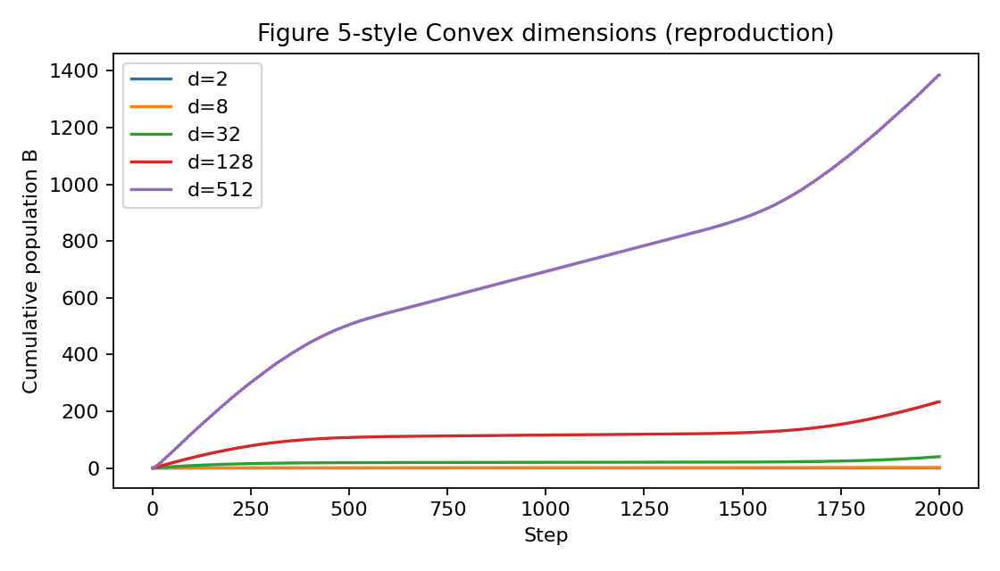
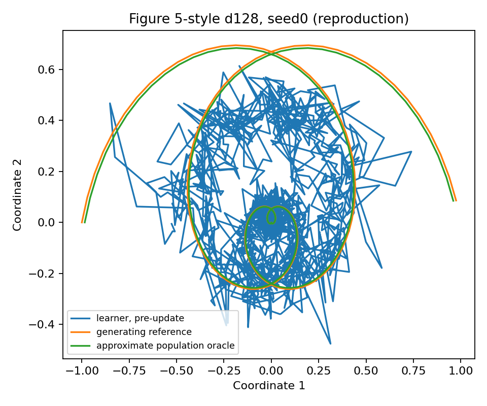
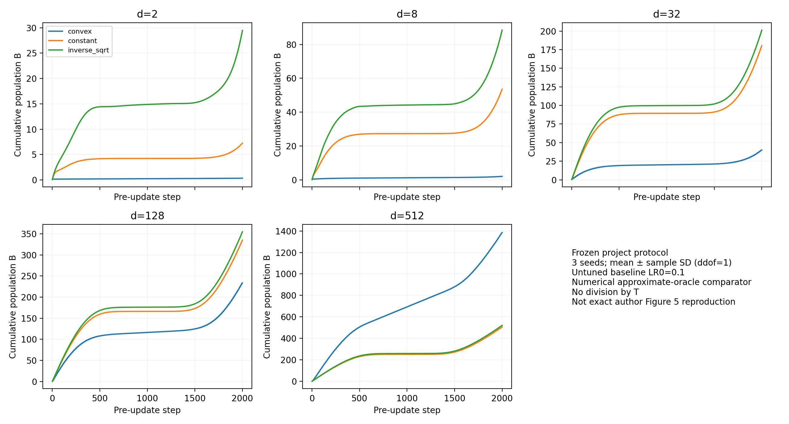
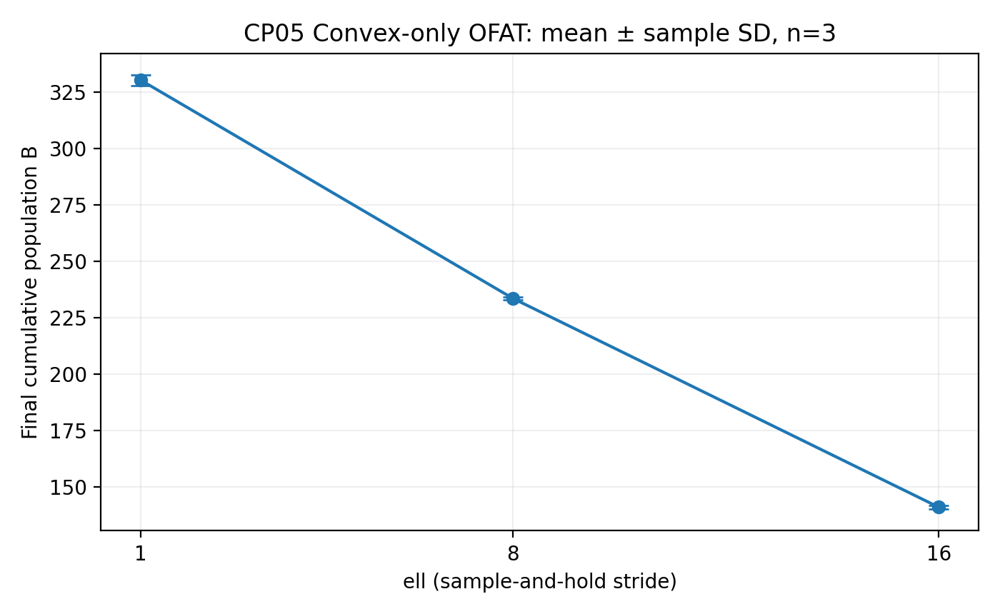
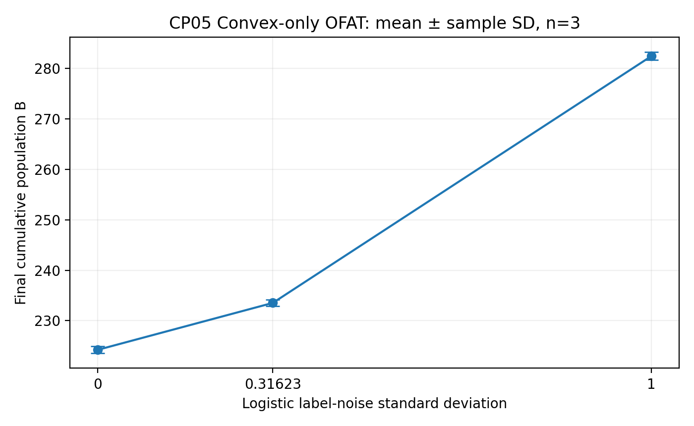
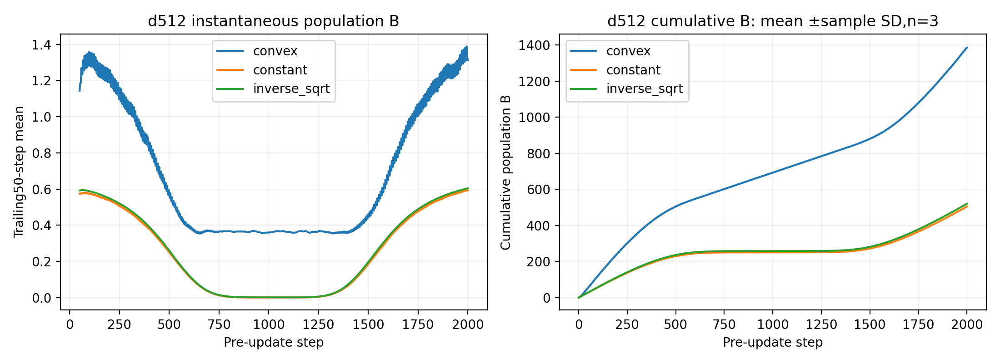

# CP04 / CP05 frozen scientific results

Documentation checkpoint CP05.6, audited 2026-11-17T08:21:27.499710+00:00. All scientific executions used source commit `7e0499c450a3e503ab09d4c6c3d272e6576b4432` ([source](https://github.com/nvk1701/github-pj/tree/7e0499c450a3e503ab09d4c6c3d272e6576b4432)). This documentation branch starts directly at that commit. No new experiments were run for CP05.6.

The public [Forge project](https://forge.coreweave.com/wandb/gr_ml_29_37_37/ml-distribution-shift) contains 45 verified CP04 reproduction runs and 15 verified CP05 sensitivity runs. [Per-run provenance](data/run_provenance.csv) records all 60 actual URLs, attempts, configuration/scientific hashes and artifact payload hashes. Original verification included fresh remote downloads and local/server/config/history/SHA256 agreement; CP05.6 rechecks live metadata and reads existing evidence. See [team/public-access audit](WANDB_TEAM_READINESS.md) for its separate verification scope and legacy artifact-count caveat.

## Protocol and interpretation

Frozen project protocol `convex-cp03-v1`: T=2000, train batch=256, evaluation batch=512, seeds 0/1/2, dimensions 2/8/32/128/512, methods convex/constant/inverse_sqrt. Convex uses estimated learner-motion EMA (decay .9), a=1, b=-1, k=4, ell=8, eta_init=1; L=.25, variance profile d/4, theoretical diameter d, projection radius d/2. Baselines use declared untuned LR0=.1. Label-noise standard deviation is sqrt(.1), oracle tolerance 1e-11, dashboard stride 20. Full scientific settings remain at the frozen source and per-run config hashes.

Primary B is cumulative deterministic Gaussian population risk minus risk at the numerical approximate population oracle; secondary A uses the generating reference. Values are sums, not divided by T. Lower B is better within the stated distribution/comparator. Sample SD is across three training seeds (ddof=1), separate from conditional Monte Carlo SE and numerical quadrature/oracle error estimates. Signed MC excess values are preserved; estimates are not clipped and numerical error estimates are not formal certificates.

## CP04: all 45 official cells

| Dimension | Method | Final B mean | Sample SD B | Final A mean |
|---|---|---:|---:|---:|
| 2 | convex | 0.33549565 | 0.00534965 | 0.32255838 |
| 2 | constant | 7.2525183 | 0.0407603 | 7.239581 |
| 2 | inverse_sqrt | 29.46318 | 0.0764775 | 29.450242 |
| 8 | convex | 2.0332947 | 0.0122002 | 2.0071332 |
| 8 | constant | 53.536154 | 0.222659 | 53.509992 |
| 8 | inverse_sqrt | 88.415786 | 0.0393838 | 88.389625 |
| 32 | convex | 40.042302 | 0.271996 | 40.006252 |
| 32 | constant | 180.43254 | 0.34722 | 180.39649 |
| 32 | inverse_sqrt | 201.18923 | 0.127375 | 201.15318 |
| 128 | convex | 233.52078 | 0.594682 | 233.4823 |
| 128 | constant | 334.95462 | 0.282425 | 334.91614 |
| 128 | inverse_sqrt | 354.62881 | 0.053485 | 354.59033 |
| 512 | convex | 1385.0089 | 7.05997 | 1384.973 |
| 512 | constant | 504.89519 | 0.22941 | 504.85932 |
| 512 | inverse_sqrt | 520.38138 | 0.119529 | 520.34551 |

[Full 15-group table](data/cp04_method_summary.csv) includes A SD, conditional MC SE ranges and real run URLs; [45 per-seed rows](data/cp04_per_seed.csv) retain numerical diagnostics and signed MC values. All declared cells are included. Shape/finite checks, cumulative identities, pre-update replay, EMA reconstruction, uncached population-risk checks, A/B correction identity, oracle diagnostics and projection containment passed in the original analysis. Max sampled pre-update residual was 1.11e-16 and max instantaneous A/B identity residual 2.66e-15.

Convex has the lowest mean B at d=2,8,32,128. At d=512, constant wins: Convex B is 1385.0089 versus 504.8952 constant and 520.3814 inverse-sqrt. This result is retained. Three seeds and descriptive comparisons do not establish universal dominance or statistical significance; no tuning or seed selection was performed.

Figure 1. Figure-5-style left: Convex cumulative population B, all five dimensions; mean and +/- sample SD across seeds 0/1/2. This is the frozen project setup.

Figure 2. First two coordinates at d128, Convex seed0. Learner is pre-update; generating reference and approximate population oracle are distinct comparators. One declared seed, no trajectory averaging.

Figure 3. All three methods, all five dimensions; cumulative B mean +/- sample SD. The d512 baseline win remains visible.

## CP05 T17: 15 sensitivity runs, five separate protocols

Convex only, d128, one factor at a time. Each condition uses three new sensitivity attempts. The baseline numerically matches CP04 d128 Convex seed by seed, but has distinct run/attempt/artifact identities; this is not teammate-independent T19 reproduction.

| Condition | ell | Noise std | Final B mean | Sample SD B | Final A mean |
|---|---:|---:|---:|---:|---:|
| baseline | 8 | 0.31622777 | 233.52078 | 0.594682 | 233.4823 |
| ell1 | 1 | 0.31622777 | 330.32399 | 2.28998 | 330.28551 |
| ell16 | 16 | 0.31622777 | 141.03424 | 0.855599 | 140.99576 |
| noise0 | 8 | 0 | 224.21734 | 0.668739 | 224.21734 |
| noise1 | 8 | 1 | 282.45375 | 0.79617 | 279.53078 |

[Five-condition summary](data/cp05_condition_summary.csv), [15 per-seed rows](data/cp05_per_seed.csv), [12 paired changes](data/cp05_paired_differences.csv). No condition/seed was omitted; no p-value or tuned selection is claimed.

ell implements sample-and-hold using min(T,ceil(t/ell)*ell). Nonzero transitions for ell 1/8/16 are 1999/249/124 out of 1999; total variation is 1848.4981/688.79134/339.31661 and squared variation 3906.9339/4354.7217/2121.724. Thus ell is not simply an ordered speed label: transition count, jump size and variation change together. The optimizer still sees learner-motion EMA, not privileged true reference shifts.

Noise 0/sqrt(.1)/1 changes the label distribution and approximate population oracle as well as the stochastic learning problem. A/B correction sums are 0/.038484187/2.922970505. Noise-zero A=B exactly. Do not attribute the entire B difference solely to optimizer degradation. Inherited parent `label_noise_assumption` prose still describes CP04; explicit resolved `label_noise_std` and recorded CLI overrides are authoritative for these sensitivity runs.

Figure 4. Final cumulative B across declared ell conditions; three seeds per condition, mean +/- sample SD. Measured path descriptors are reported in the accompanying condition-summary table.

Figure 5. Final cumulative B across noise standard deviations; mean +/- sample SD across three seeds. A and the distribution/comparator correction are reported separately in the condition-summary table. No baseline-method sensitivity comparison was run.

## d512 diagnostic: observational, no new runs

[Diagnostic summary for all 15 method/dimension groups](data/d512_diagnostic_summary.csv) comes from the original CP04 trajectories. Convex d512 mean LR=3.988433 and 99.800% of recorded rates are >=3.96, cap=4. At d128 these are 3.973997 and 99.467%, yet Convex wins there. Max stored d512 learner norm=7.522045 versus radius256; snapshots do not touch the projection boundary. All six seed-matched Convex-minus-baseline cumulative B gaps are positive from step9 through2000, with zero gap at step1.

Figure 6. Instantaneous B uses a labelled trailing 50-step moving mean only for display; cumulative B is unmodified mean +/- sample SD. Aggressive rates, higher dimension and learner-motion EMA are consistent with a noise/tracking interaction. No ablation establishes causality or proves that reducing LR fixes d512.

## Scientific hashes and paper differences

CP04 normalized scientific SHA256: `be23ffdd8cb919f97b93bcce38c57a28fd531de854b5e2a3b9bdcb4239d2f891`. Five CP05 hashes are intentionally distinct; no standard 45-cell merge or weakened hash guard was used.

| CP05 condition | Normalized scientific SHA256 |
|---|---|
| baseline | `e84ff5bd71145d45f9b2eb74bdf04f55b7824034054d54af17a3d8016ebb6075` |
| ell1 | `98feadb05ac99490ef6332cff1ca06090b40b29fa88df5a22655849047119296` |
| ell16 | `bffb9c7eeaf2c88028ada332d1415b7f356f0f099bebc27fc7ed110803fb9c30` |
| noise0 | `c956f42f180145fe9e4aef80a7f21663d982f0647931154ca93ca5cb348202e6` |
| noise1 | `6de49c995b0a94da17f52a8e034dbfed37b68d107491a9d0a6d13cfa70450a35` |

Scientific hash normalizes scientific settings; config hash includes attempt metadata. Artifact `config.json` byte SHA256 is a third, distinct hash. All are labelled in [provenance](data/run_provenance.csv). [Publication manifest](publication_manifest.json) hashes every published document/table/figure except itself; figures are byte-identical copies of existing outputs. Raw NPZ, SDK logs, downloads and credentials are excluded.

The prior author-notebook audit found noise std .1 versus project sqrt(.1); true reference-shift gamma versus estimated learner EMA; empirical generating-reference comparator versus deterministic population B; different first-step tau behavior versus eta_init=1, plus float32/path-construction differences. This is a verified frozen-project execution and Figure-5-style comparison, not an exact author reproduction. A directly comparable paper scalar and meaningful relative deviation remain N/A. No theoretical uniform-assumption certificate is claimed for the EMA+d/4 profile.

T15 experiment evidence is available but full acceptance still needs paper-comparison review and independent T19. T17 is verified exploratory Convex-only OFAT; broader sensitivity acceptance is not implied. Khoa/Hoa must perform their own authorized cross-checks and team logging, and slide/workbook updates remain separate human review. CP05.6 does not alter their files, source science, shared tracking code, workbook or W&B results.
